# PulseNotify

A flight price monitoring and alert service. Users register, create price alerts for a route
(for example *notify me when DEL-BOM drops to ₹4500 or below*), and a background worker checks prices
every 60 seconds and records a notification when a threshold is met.

**Stack:** Django 6 · Django REST Framework · SimpleJWT · Celery + Celery Beat · Redis · PostgreSQL · Docker Compose

```
Client -> POST /api/alerts/ ----------------------------> PriceAlert (PostgreSQL)

Celery Beat (every 60 s)
   -> check_prices  --GET /api/flights/price/?route=X-->  internal mock price feed
        price <= threshold ?
   -> send_notification.delay()  (async, via Redis)
        -> NotificationLog row + alert status = "triggered"

Admin -> GET /api/admin/summary/
```

Repository: https://github.com/sushmithak-03997/pulsenotify

---

## Requirements coverage

| Requirement | Implementation |
|---|---|
| JWT authentication, register / login | `pulse/views.py` (`RegisterView`, `LoginView`), SimpleJWT access tokens |
| Alert CRUD scoped per user | `AlertListCreateView`, `AlertDetailView`; querysets filtered by `request.user` |
| Soft delete | `DELETE /api/alerts/<id>/` sets `status = inactive` |
| Mock price feed (no auth) | `get_flight_price` in `pulse/views.py`, ranges in `pulse/constants.py` |
| Periodic price check every 60 s | `check_prices` + `CELERY_BEAT_SCHEDULE` in `pulsenotify/settings/base.py` |
| Async notification | `send_notification.delay()` from `check_prices`, writes `NotificationLog` |
| Role-based admin endpoint | custom `IsAdminUser` in `pulse/permissions.py` on `GET /api/admin/summary/` |
| Auto-created profile | `post_save` signal in `pulse/signals.py`, connected in `PulseConfig.ready()` |
| Split settings | `pulsenotify/settings/{base,local,production}.py` |
| Secrets from environment | `.env` (git-ignored), template in `.env.example` |
| PostgreSQL + Redis via Docker | `docker-compose.yml` |
| Unit tests | `pulse/tests.py` (38 tests) |
| Postman collection | `postman/PulseNotify.postman_collection.json` (17 requests, 28 assertions) |

---

## Running the project

Prerequisites: Python 3.12, 3.13 or 3.14 (Django 6 requires 3.12+), Docker (with Compose), Git.

```bash
git clone https://github.com/sushmithak-03997/pulsenotify.git
cd pulsenotify

python -m venv .venv
source .venv/bin/activate            # Windows PowerShell: .venv\Scripts\Activate.ps1
pip install -r requirements.txt

cp .env.example .env                 # Windows: copy .env.example .env
docker compose up -d db redis        # PostgreSQL 16 + Redis 7

python manage.py migrate
python manage.py createsuperuser     # superusers receive the "admin" role automatically
```

Start the three processes, each in its own terminal with the virtual environment active:

| # | Command | Purpose |
|---|---|---|
| 1 | `python manage.py runserver` | REST API on http://localhost:8000 |
| 2 | `celery -A pulsenotify worker --loglevel=info --pool=solo` | executes `check_prices` / `send_notification` |
| 3 | `celery -A pulsenotify beat --loglevel=info` | schedules `check_prices` every 60 s |

The default `.env.example` values work as-is with the provided `docker-compose.yml`.

> `--pool=solo` runs the worker in a single process. It is required on macOS and Windows, where Celery's default
> prefork pool can fail with `ValueError: not enough values to unpack`; on Linux the default pool also works.

---

## Verifying the system

### 1. Unit tests

```bash
python manage.py test
```

Expected: `Ran 38 tests ... OK`. Coverage: threshold comparison, `NotificationLog` creation and idempotency,
per-user alert scoping, the `check_prices` task (price feed mocked, including timeout and 404 handling),
registration / login, input validation, the mock feed, and the admin summary.
(`USE_SQLITE=1 python manage.py test` runs the same suite without Docker.)

### 2. Postman collection

1. Postman -> **Import** -> `postman/PulseNotify.postman_collection.json`.
2. Open the collection -> **Run** -> run all requests in order.
3. Requests 01-15 need no setup (unique usernames are generated on every run).
4. Requests 16-17 use the collection variables `admin_user` / `admin_password`
   (defaults `admin` / `admin12345`). Set them to the superuser created above.

Expected: 17 requests, 28 assertions, 0 failures.

### 3. End-to-end background processing

1. Register and log in, then create an alert that will always fire:
   ```bash
   curl -X POST http://localhost:8000/api/alerts/ \
     -H "Authorization: Bearer <access_token>" -H "Content-Type: application/json" \
     -d '{"origin":"DEL","destination":"BOM","threshold_price":99999}'
   ```
2. Within 60 seconds the Beat terminal logs `Sending due task ... check_prices` and the worker terminal logs
   `Price alert triggered! DEL-BOM is now ₹<price> ...`.
3. `GET /api/alerts/` now shows `"status": "triggered"`, and `GET /api/admin/summary/` (admin token) reports
   `total_notifications >= 1`. The row is also visible in the `pulse_notificationlog` table.

---

## API reference

All endpoints are under `/api/`. Authenticated endpoints expect `Authorization: Bearer <access>`.

| Method & path | Auth | Behaviour |
|---|---|---|
| `POST /auth/register/` | public | `{username, password, email}` -> `201 {username, access, role}`; `400` if the username exists. A `role` field in the body is ignored. |
| `POST /auth/login/` | public | `{username, password}` -> `200 {username, access, role}`; `401` on invalid credentials. |
| `POST /alerts/` | JWT | `{origin, destination, threshold_price}` -> `201`. Owner is taken from the token; status always starts as `active`. |
| `GET /alerts/` | JWT | The caller's alerts only; `[]` (never 404) when there are none. |
| `DELETE /alerts/<id>/` | JWT | `200 {"status": "inactive"}`. `404` if the alert does not exist **or belongs to another user**. |
| `GET /flights/price/?route=DEL-BOM` | public | `{route, price}` (random price in the route's range); `404` for an unknown route. |
| `GET /admin/summary/` | JWT, admin role | `total_alerts, active_alerts, triggered_alerts, total_notifications, top_routes`; `403` for non-admins. |

Supported mock routes: `DEL-BOM`, `BLR-HYD`, `DEL-BLR`, `BOM-GOA`.
Admin role: assigned automatically to superusers, or set `role = admin` on a row in `pulse_userprofile`
(Django admin is available at `/django-admin/`).

---

## Design decisions

- **Non-blocking checks.** `check_prices` only queues `send_notification.delay()`; it never waits on notification work.
- **No duplicate notifications.** `send_notification` locks the alert row (`select_for_update`) and acts only on
  `active` alerts, so overlapping Beat runs or a deactivation mid-flight cannot produce duplicates.
- **Fault tolerance.** Price-feed timeouts, connection errors and non-200 responses skip that route and are logged;
  the periodic job itself never crashes.
- **One request per route.** Alerts are grouped by route so the feed is called once per route per cycle, not once per alert.
- **Security.** Everything except register, login and the price feed requires a valid JWT. Another user's alert
  returns `404` rather than `403` so its existence is not disclosed. Roles are never accepted from request input.
- **Configurable feed URL.** `PRICE_FEED_URL` is an environment variable, so the worker can reach the API
  from inside a container if the project is later containerised.

## Project layout

```
pulsenotify/             project package: settings/{base,local,production}.py, celery.py, urls.py
pulse/                   app: models, signals, permissions, serializers, views, tasks, tests, migrations
postman/                 Postman collection
screenshots/             captured evidence of a full run (see below)
docker-compose.yml       PostgreSQL + Redis (+ optional pgAdmin: docker compose --profile pgadmin up -d pgadmin)
.env.example             environment template (the real .env is git-ignored)
```

## Evidence of a full run

Screenshots captured from a complete run on macOS (Python 3.12, Docker Desktop, PostgreSQL 16, Redis 7).
They follow the order in which the system is brought up and exercised.

### A. Infrastructure and tests

**1. PostgreSQL and Redis containers, then database migrations.** `docker compose up -d db redis` starts both
services (`pulsenotify_db` reports *healthy*, `pulsenotify_redis` is up), and `python manage.py migrate` applies
every migration, including `pulse.0001_initial`.

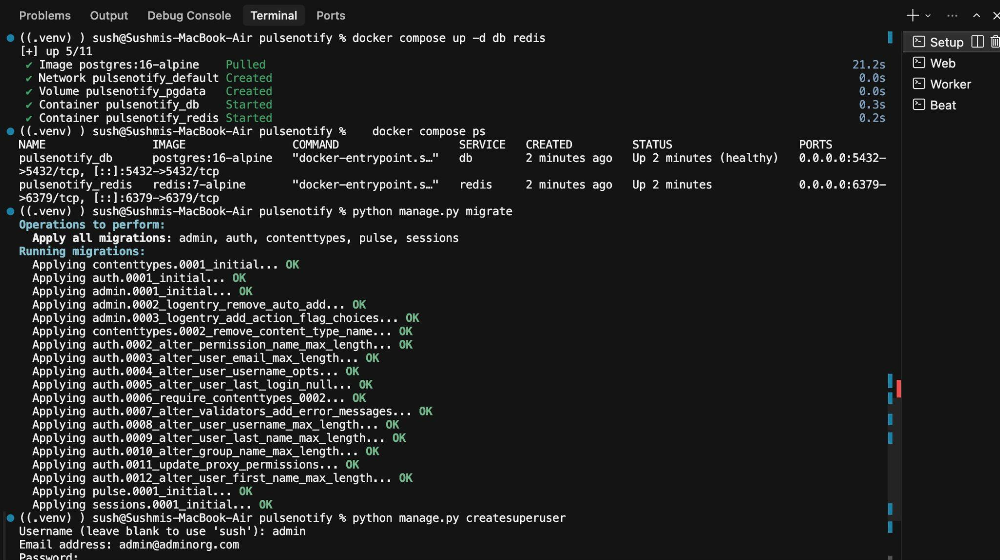

**2. Unit tests.** A superuser is created, then `python manage.py test` runs **38 tests, all passing**.
(The `Price feed unreachable ... down` line is expected output: one test deliberately simulates a failing price feed.)

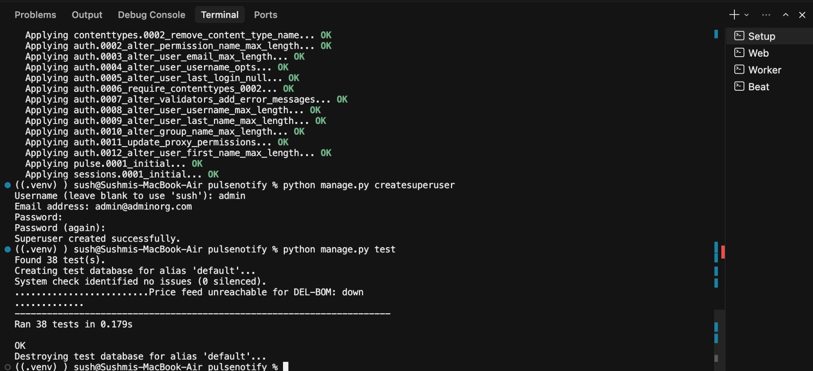

### B. The three running processes

**3. API server.** `python manage.py runserver` starts Django (settings module `pulsenotify.settings.local`).
The log shows `200` responses from the price feed endpoint.

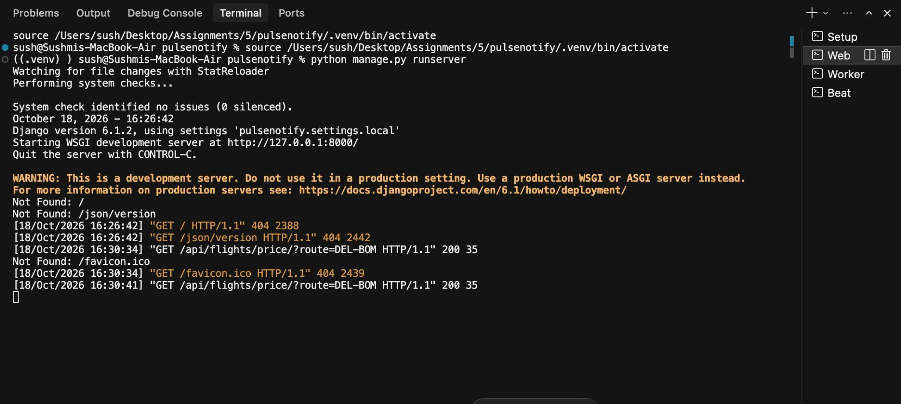

**4. Celery worker.** Both tasks are registered (`pulse.tasks.check_prices`, `pulse.tasks.send_notification`) and the
worker is connected to Redis. Once a minute it receives and completes `check_prices`; with no active alerts it reports
`0 route(s) checked`.

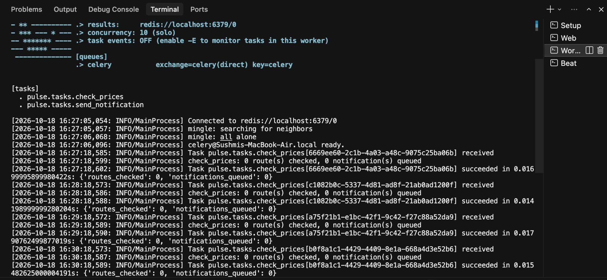

**5. Celery Beat.** The scheduler sends `check-flight-prices-every-minute` at 60-second intervals
(16:27:18, 16:28:18, 16:29:18 ...), which is what drives the worker above.

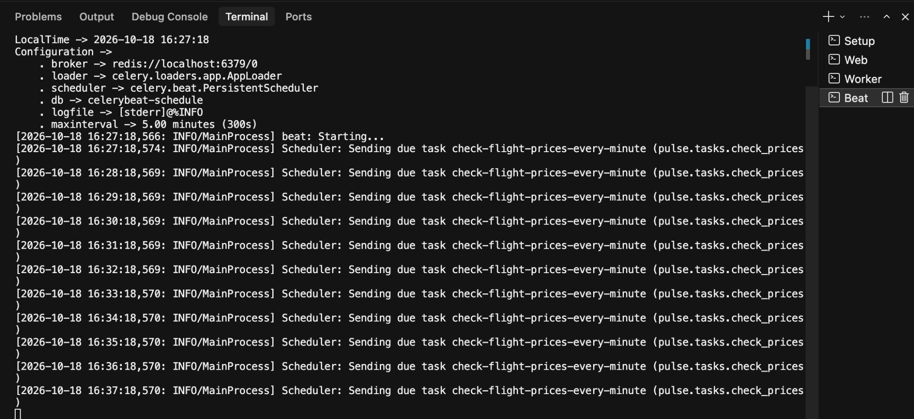

**6. Mock price feed.** `GET /api/flights/price/?route=DEL-BOM` needs no authentication and returns a random price
within the route's range.

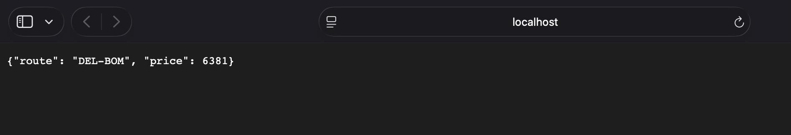

### C. API behaviour (Postman)

**7. Full collection run.** All requests of the Postman collection executed in order: **28 assertions, 28 passed,
0 failed, 0 errors**.

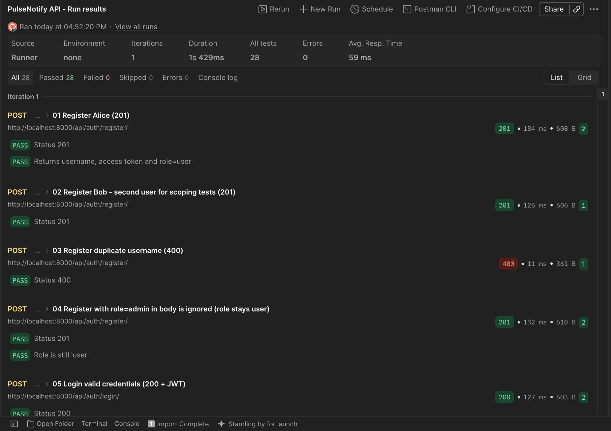

**8. Registration.** `POST /api/auth/register/` returns `201 Created` with a JWT access token and `"role": "user"`.

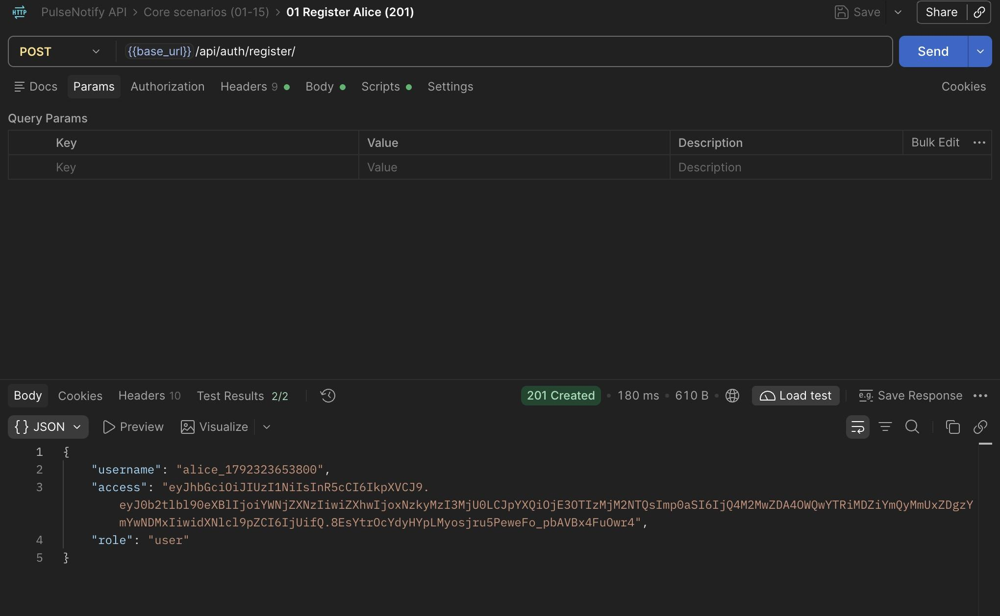

**9. Login.** `POST /api/auth/login/` returns `200 OK` with a fresh token for the same user.

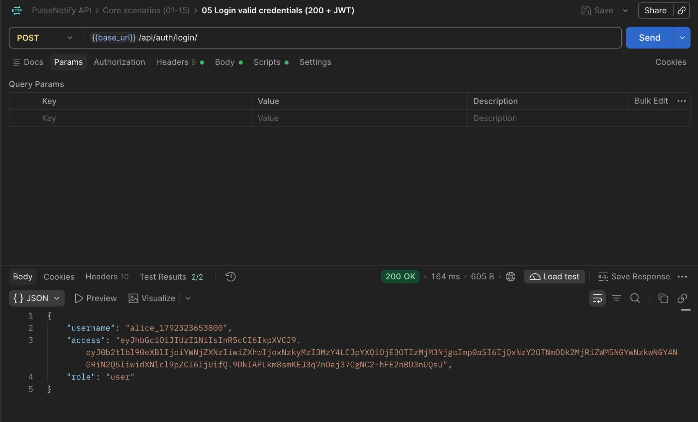

**10. Creating a price alert.** `POST /api/alerts/` returns `201 Created`; the alert starts as `"status": "active"`.
A high threshold (`999999`) is used here so the alert is guaranteed to fire on the next price check. (Postman shows 1/2
test results because the collection's own assertion expects the default threshold of `4500`.)

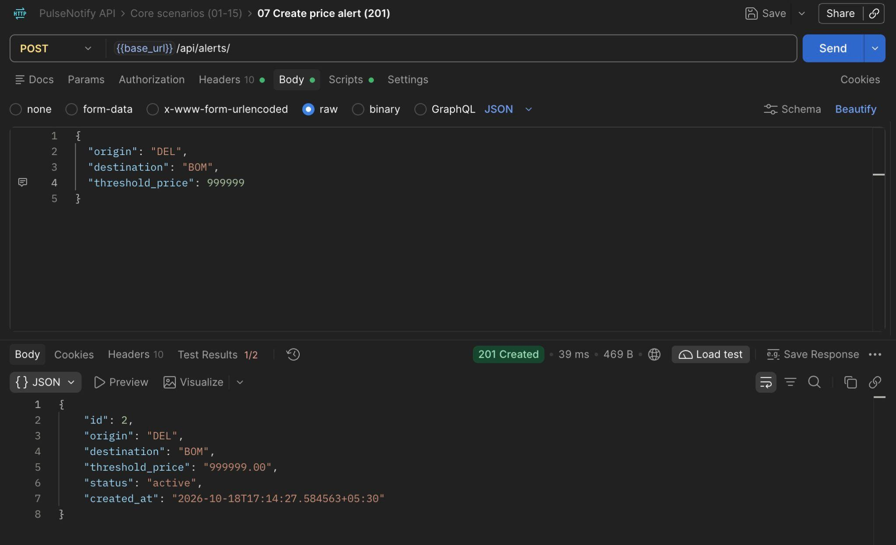

### D. Background processing, end to end

**11. The worker fires the alert.** On the next Beat tick, `check_prices` reports `1 route(s) checked, 1 notification(s)
queued`, then `send_notification` runs and logs `Price alert triggered! DEL-BOM is now ₹3075 - below your threshold of
₹999999.00`.

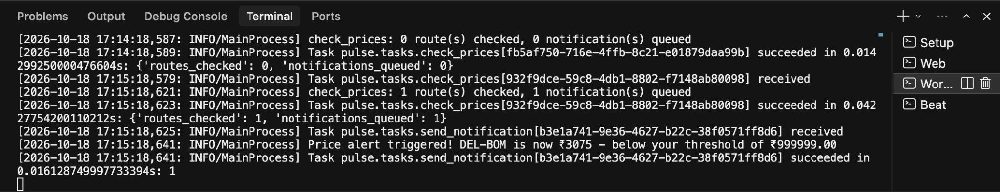

**12. The result in PostgreSQL.** The `pulse_notificationlog` table now contains the notification for alert `2` with the
triggered price `3075.00`.

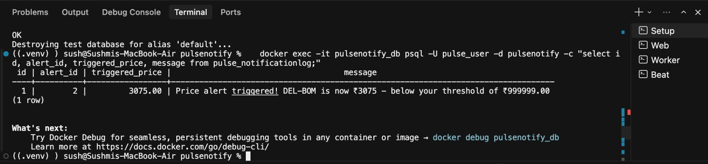

### E. Role-based access

**13. A normal user is refused.** `GET /api/admin/summary/` with a regular user's token returns `403 Forbidden`
(`"Admin access required."`).

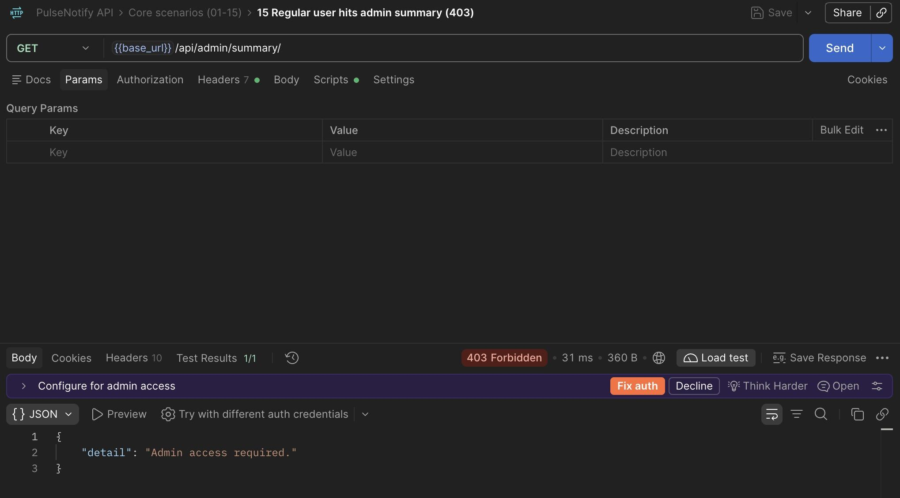

**14. Admin login.** Logging in as the superuser returns `"role": "admin"`.

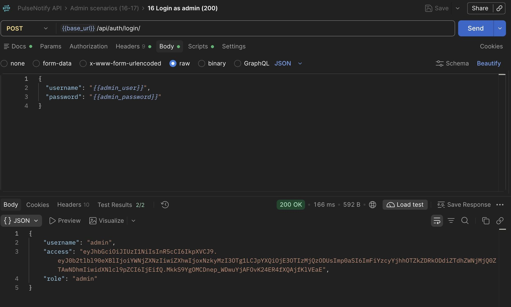

**15. Admin summary.** With the admin token the same endpoint returns `200 OK` and the aggregate statistics, which
match what the previous steps produced: 2 alerts in total, 1 `triggered`, 1 notification, `DEL-BOM` as the top route.

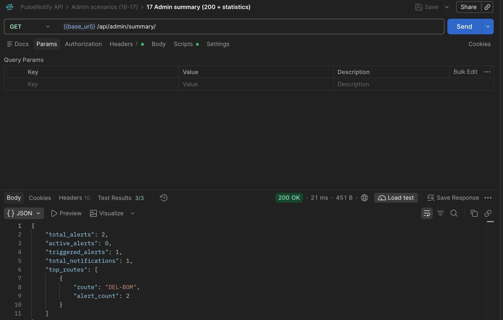
